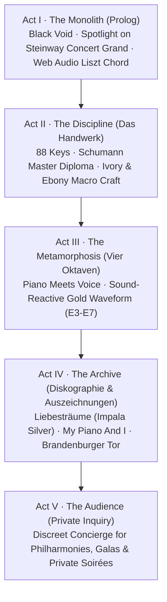

# MASTER-PROMPT · Elena Nuzman
## The Definitive Creative & Technical Blueprint for an Ultra-Luxury Scroll-Telling Experience

---

### 1. EXECUTIVE MISSION & CORE DNA
Build a digital masterpiece for **Elena Nuzman**—world-class concert pianist, composer, and four-octave crossover vocalist. The website must not look like an ordinary portfolio or standard musician template. It must embody the aesthetic authority and emotional weight of **Steinway & Sons, Koenigsegg, and Cartier**:

> **«Der Flügel im Schatten · Vier Oktaven Gravitation.»**  
> *A concert grand piano is not merely an instrument. It is an extension of bone, thought, and breath. When classical virtuosity meets four octaves of vocal power, acoustic boundaries cease to exist.*

---

### 2. VERIFIED ARTIST DOSSIER & FACTS (100% AUTHENTIC)
- **Origin & Dynasty:** Born 1981 in Moldova into a renowned musical lineage.
  - Mother: Nina Kvasowa (celebrated concert pianist).
  - Father: Josef Nuzman (acclaimed violin virtuoso and actor).
- **Prodigy Roots:** Played complex melodies by ear at age 2. Admitted to the prestigious elite music lyceum for gifted children at age 7. Touring concert stages internationally by age 17 across Russia, France, and the USA.
- **Academic Mastery:** Master Degree & State Diploma as Concert Pianist (*Diplom-Konzertpianistin*) from the world-renowned **Robert Schumann Hochschule Düsseldorf**.
- **The Dual Phenomenon (Vocal Discovery):** Discovered an astonishing **4-octave vocal range** during her classical university studies. Won a premier national vocal competition, igniting her signature classical crossover direction.
- **Milestones & Global Stages:**
  - **Impala Silver Award:** Awarded for the international streaming sensation *Liebesträume* (vocal and modern orchestral adaptation of Franz Liszt’s *Liebestraum No. 3*), generating millions of streams worldwide.
  - **RTL Album of the Year:** Awarded for her debut studio album *I Believe In You* (Top 10 German Newcomer Charts).
  - **Brandenburg Gate (Berlin NYE):** Headlined the massive New Year's Eve broadcast live before millions of television viewers with her symphonic rock rendition of Whitesnake’s *Here I Go Again*.
  - **Broadway (New York City):** Featured live solo showcase performances in Manhattan.
  - **ABBA Composers Authorization:** Personally authorized by Benny Andersson and Björn Ulvaeus to release the official German rendition of *The Winner Takes It All* (*«Nur die Sieger steh'n im Licht»*).
  - **2025 Release:** Studio Album *My Piano And I*—intimate, raw, grand piano and vocal recordings.

---

### 3. SCROLL-TELLING DRAMATURGY (5-ACT ARCHITECTURE)



#### Act I · The Monolith (Prolog & Hero)
- Dark ambient void (`#08080a`). Single ceiling spotlight slicing through atmospheric haze onto the high-gloss black lacquer of a concert grand.
- Minimalist typography: Cormorant Garamond paired with tracked monospaced coordinates (`DÜSSELDORF · NEW YORK · WORLDWIDE`).
- Audio toggle triggering a lush, warm synthetic Franz Liszt A-flat major chord via Web Audio API.

#### Act II · The Discipline (88 Tasten & Handwerk)
- Macro perspective: Hand movements, felt dampers lifting from bronze bass strings, mechanical hammer precision.
- Narrative cards: The Moldovan prodigy timeline, Robert Schumann Hochschule diploma, the rigor of classical mastery.

#### Act III · The Metamorphosis (Vier Oktaven)
- The pivotal revelation: Elena does not merely play the concert grand; she accompanies herself with a 4-octave vocal range.
- Interactive **Champagne-Gold Waveform (`VoiceWave.tsx`)** responding in real time to scroll progress and sound frequencies.

#### Act IV · The Archive (Ausgewählte Werke)
- Curated album vault:
  1. *Liebesträume* (Franz Liszt Crossover · Impala Silver Award · Millions of Streams)
  2. *My Piano And I* (2025 Studio Album · Pure Solo Grand & Voice)
  3. *Here I Go Again* (Live Brandenburger Tor NYE · Symphonic Rock)
  4. *I Believe In You* (Debut · RTL Album des Jahres)
- Interactive track drawer with BPM, frequency range, and audio preview simulator.

#### Act V · The Audience (Private Inquiry & Booking)
- Exclusive booking concierge for symphony halls, private collectors, luxury galas, and corporate soirées.
- Instant VIP dossier routing and validation.

---

### 4. DESIGN TOKENS & VISUAL IDENTITY
- **Backgrounds:** `#08080a` (Obsidian Ink), `#121216` (Deep Ebony), `#1c1b18` (Warm Charcoal).
- **Accents:** `#d4af37` (Champagne Gold), `#f5e6d3` (Warm Ivory), `#ffffff` (Pure Light).
- **Typography:**
  - Display: `Cormorant Garamond` (Light 300, Regular 400, Italic).
  - Body: `Inter` (Extra-Light 200, Light 300, Regular 400).
  - Meta/Accents: Monospace tracking (`letter-spacing: 0.25em`).
- **Texture:** Fixed 35mm analog film grain overlay (`FilmGrain.tsx`) calculated via browser SVG fractal noise (zero bandwidth, zero lag).

---

### 5. FAL.AI PROMPT LIBRARY (FOR 8K FLUX PRO GENERATIONS)

```json
{
  "hero_piano": {
    "prompt": "Cinematic wide shot of a master concert grand piano on a dark polished stage, single vertical warm beam of light illuminating the high-gloss black lacquer and open lid, subtle dust motes floating in the spotlight, deep obsidian shadows, chiaroscuro lighting, luxury Steinway aesthetic, shot on 35mm Arri Alexa, anamorphic lens, 8k resolution, photorealistic",
    "aspect_ratio": "16:9"
  },
  "macro_keys": {
    "prompt": "Extreme macro close-up of vintage grand piano keys, smooth ivory and matte ebony, shallow depth of field, warm golden ambient rim lighting reflecting off the polished black rim, micro dust details, exquisite craftsmanship, cinematic editorial photography, 8k",
    "aspect_ratio": "4:3"
  },
  "grand_interior": {
    "prompt": "Overhead cinematic view into the interior soundboard of a concert grand piano, gleaming brass and bronze wound strings, cast iron plate painted in warm gold, red felt dampers, soft dramatic side lighting, rich metallic reflections, photorealistic, masterwork detail",
    "aspect_ratio": "16:9"
  },
  "artist_chiaroscuro": {
    "prompt": "Dramatic chiaroscuro editorial portrait of a virtuoso female concert pianist in a dark concert hall, elegant black silk evening attire, hands gracefully positioned above grand piano keys, profile view softly sculpted by warm rim light, quiet intensity, timeless elegance, Vogue and Vanity Fair editorial style, 8k",
    "aspect_ratio": "4:5"
  }
}
```

---

### 6. TECHNICAL STACK & CONSTRAINTS
- **Framework:** Next.js 14 App Router, TypeScript, Tailwind CSS.
- **Scroll Engine:** Lenis Smooth Scroll with `lerp: 0.08` + GSAP ScrollTrigger.
- **Audio Engine:** Web Audio API (native browser oscillator bank for chord resonance, zero external audio dependency).
- **Performance Budget:** First Load JS < 110 kB.
- **Responsive Standard:** Flawless layout across Desktop (1440px), Tablet (768px), and Mobile (390px). No horizontal overflow.
- **Reduced Motion:** Graceful, elegant degradation when `prefers-reduced-motion` is active.
